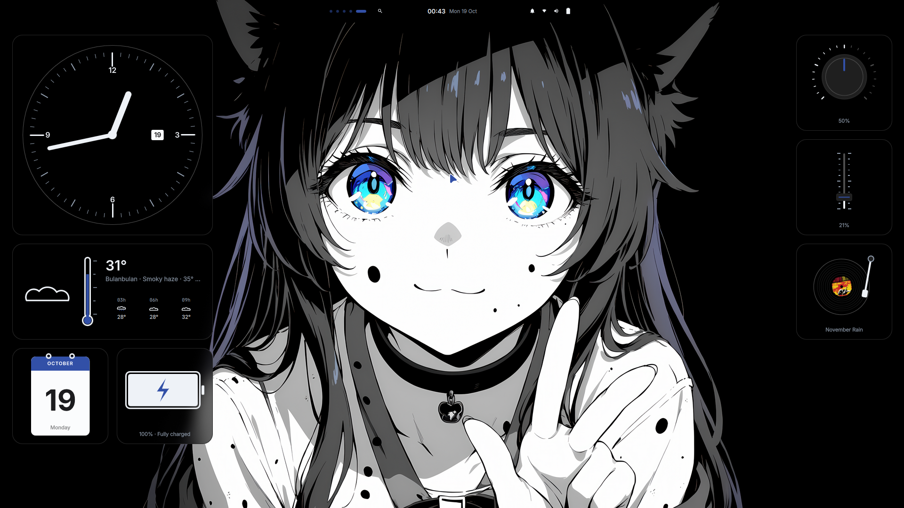
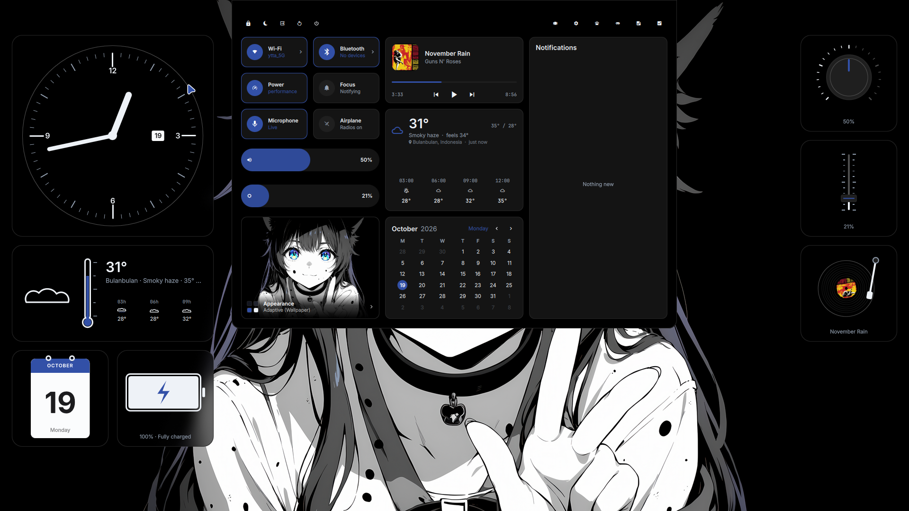

<p align="center">                                                                                 
                   
    </p>                                                                                               
                                                                                                       
    <p align="center">                                                                                 
      <b>🍙 ZenSetup — A monochromatic Hyprland rice with analogue soul.</b><br>                       
      Powered by Quickshell, themed after a monochrome aesthetic with vivid highlights,<br>            
      featuring analogue desktop widgets, dynamic island controls, and managed effortlessly via GNU    
  Stow.                                                                                                
    </p>                                                                                               
                                                                                                       
    <p align="center">                                                                                 
                                                   
                                                      
                                                                                          
                                                                                                     
      <a href="LICENSE"></a>                                                                           
    </p>                                                                                               
                                                                                                       
    <p align="center">                                                                                 
      <a href="#overview">Overview</a> ·                                                               
      <a href="#the-island--control-centre">The Island</a> ·                                           
      <a href="#analogue-desktop">Analogue Desktop</a> ·                                               
      <a href="#components">Components</a> ·                                                           
      <a href="#installation">Installation</a> ·                                                       
      <a href="#credits">Credits</a>                                                                   
    </p>                                                                                               
                                                                                                       
    ---                                                                                                
                                                                                                       
    ## Overview                                                                                        
                                                                                                       
    **ZenSetup** is a personalized Hyprland dotfiles environment built around the incredible foundation
  of **Impasto**. It transforms your desktop into an artful workspace where monochrome anime aesthetics
  meet tactile analogue instruments.                                                                   
                                                                                                       
    - **Dynamic Island:** A living pill bar that morphs into music controls, system stats, quick       
  toggles, and notification previews.                                                                  
    - **Analogue Widgets:** Physical-feeling clock, thermometer, calendar, battery gauge, dial volume  
  knob, brightness fader, and turntable music player.                                                  
    - **Modular Management:** Everything is organized into clean packages managed by **GNU Stow** for  
  seamless deployment.                                                                                 
                                                                                                       
    ---                                                                                                
                                                                                                       
    ## The Island & Control Centre                                                                     
                                                                                                       
    <p align="center">                                                                                 
          
    </p>                                                                                               
                                                                                                       
    The central capsule expands into a full control centre with:                                       
    - **Media Controller:** Real-time playback status with artwork, scrubber, and playback buttons.    
    - **Quick Toggles:** Wi-Fi, Bluetooth, Performance profiles, Notification focus, Microphone, and   
  Airplane mode.                                                                                       
    - **Weather & Forecast:** Live conditions and temperature curves.                                  
    - **Calendar & Notifications:** Monthly view alongside a unified notification hub.                 
                                                                                                       
    ---                                                                                                
                                                                                                       
    ## Analogue Desktop                                                                                
                                                                                                       
    The desktop surface features widgets drawn in a tactile analogue theme:                            
    - **Left Desk:** Wall clock with date window, glass thermometer showing temperature and atmospheric
  conditions, tear-off monthly calendar, and battery cell gauge.                                       
    - **Right Desk:** Rotary dial volume knob, vertical fader for screen brightness, and a spinning    
  vinyl turntable playing your current tracks.                                                         
                                                                                                       
    ---                                                                                                
                                                                                                       
    ## Components                                                                                      
                                                                                                       
    | | Component | Tool |                                                                             
    |---|---|---|                                                                                      
    | 🪟 | **Compositor** | [Hyprland](https://hypr.land) |                                            
    | 🐚 | **Shell & Widgets** | [Quickshell](https://quickshell.org) |                                
    | 📁 | **Dotfiles Manager** | [GNU Stow](https://www.gnu.org/software/stow/) |                     
    | 🔒 | **Screen Locker** | [hyprlock](https://github.com/hyprwm/hyprlock) |                        
    | 💤 | **Idle Daemon** | [hypridle](https://github.com/hyprwm/hypridle) |                          
    | 🎨 | **Original Rice Base** | [Impasto](https://github.com/andreumassanet/impasto) |             
                                                                                                       
    ---                                                                                                
                                                                                                       
    ## Installation                                                                                    
                                                                                                       
    ### 1. Requirements                                                                                
                                                                                                       
    Ensure you are running **Arch Linux / CachyOS** with **Hyprland** and **Quickshell** installed:    
                                                                                                       
    ```bash                                                                                            
    sudo pacman -S --needed hyprland stow git hyprlock hypridle                                        
                                                                                                       
  ### 2. Clone Repository                                                                              
                                                                                                       
    git clone https://github.com/ShinNouzen/zensetup.git ~/zensetup                                    
    cd ~/zensetup                                                                                      
                                                                                                       
  ### 3. Deploy via GNU Stow                                                                           
                                                                                                       
  Deploy configurations directly to your $HOME directory:                                              
                                                                                                       
    stow quickshell                                                                                    
    stow hypr                                                                                          
    stow wallpapers                                                                                    
                                                                                                       
  (To remove or unlink any module later, simply run stow -D <module>).                                 
  ──────                                                                                               
  ## Credits & Acknowledgements                                                                        
                                                                                                       
  This setup is built on top of the visionary work of Impasto by @andreumassanet                       
  https://github.com/andreumassanet.                                                                   
                                                                                                       
  • Original Project: andreumassanet/impasto https://github.com/andreumassanet/impasto                 
  • Quickshell Framework: outfoxxed/quickshell https://quickshell.org                                  
  • Compositor: Hyprland https://hypr.land                                                             
  ──────ZenSetup — Maintained by ShinNouzen                                                            
  
  ```
